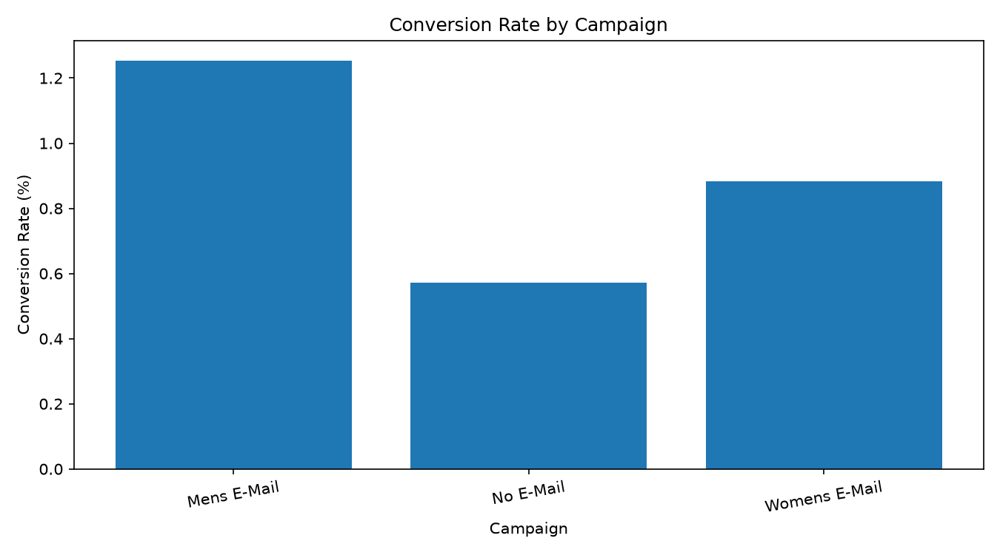
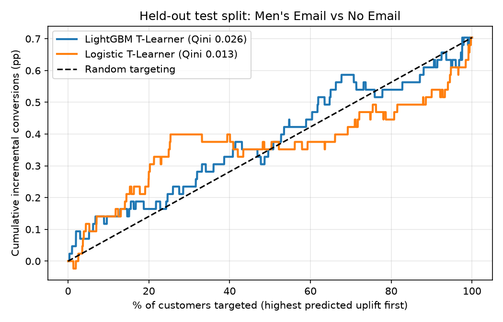
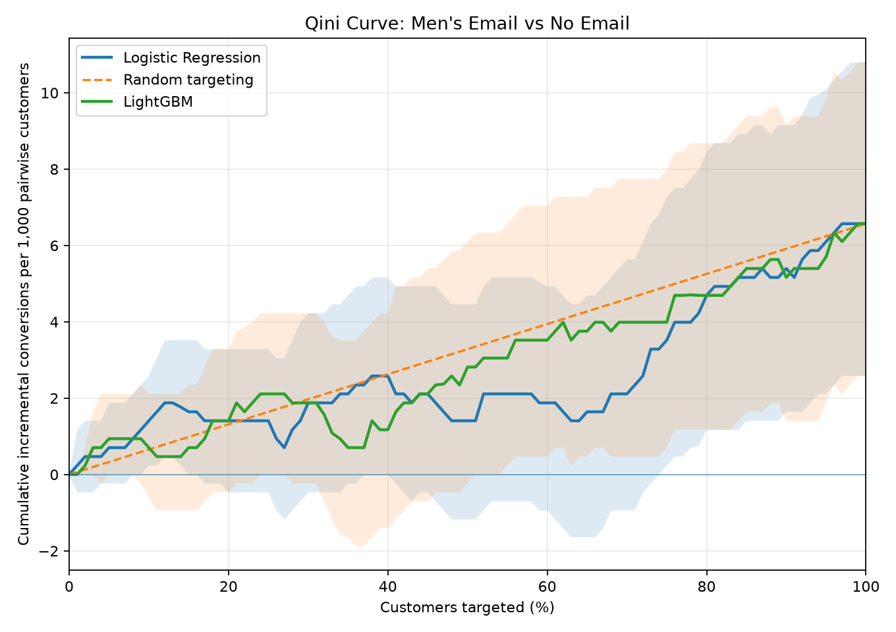
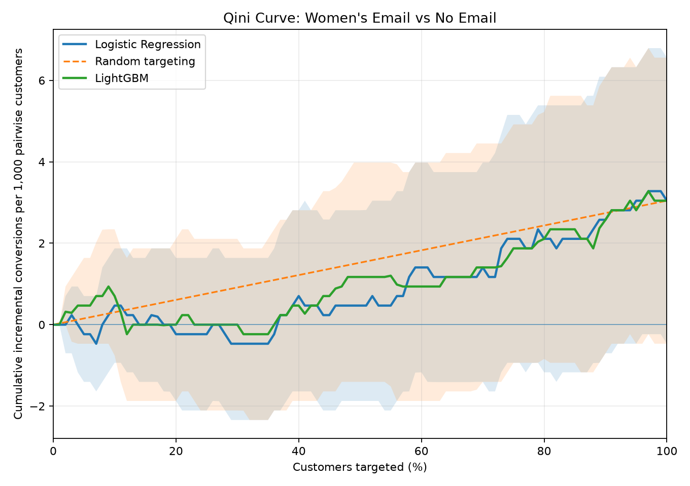

# Uplift Modelling on the Hillstrom Email Campaign

This project studies **uplift modelling**: estimating which customers are more likely to convert *because they received a campaign*, rather than simply predicting which customers are likely to purchase.

It uses the randomized Hillstrom email-marketing experiment and compares customer-level uplift rankings with simple campaign-wide policies. The results are intentionally reported with their limitations: the campaigns have measurable aggregate conversion differences, but the experiments here do **not** establish a reliable personalized targeting strategy.

---

## Project at a glance

- **Dataset:** 64,000 customers from the Hillstrom MineThatData email experiment.
- **Treatments:** No Email, Men's Email and Women's Email.
- **Primary two-arm comparison:** Men's Email versus No Email.
- **Two-arm models:** Logistic T-Learner, S-Learner, X-Learner and LightGBM T-Learner.
- **Three-arm evaluation:** Logistic and LightGBM T-Learners across all three campaign arms.
- **Evaluation:** Qini/AUUC, uplift at top-k, probability metrics, nested cross-validation, corrected pairwise comparisons, IPW and doubly robust policy value.
- **Reproducible data access:** scikit-uplift's fetch_hillstrom.
- **Tests:** GitHub Actions workflow running pytest on Python 3.11.

## Dataset and campaign overview

The Hillstrom dataset contains 64,000 customers randomly assigned to one of three campaign groups. The conversion outcome records whether a customer made a purchase during the follow-up period.

| Campaign | Customers | Conversions | Conversion rate |
|---|---:|---:|---:|
| Men's Email | 21,307 | 267 | 1.253% |
| Women's Email | 21,387 | 189 | 0.884% |
| No Email | 21,306 | 122 | 0.573% |
| **Total** | **64,000** | **578** | **0.903%** |

The aggregate conversion rates show that the email groups converted more often than the no-email group in this experiment. That aggregate difference does not, by itself, show which individual customers benefit from an email or whether an uplift model can identify them reliably.

### Campaign conversion visual

*Project-generated EDA figure: observed conversion rate by randomized campaign group.*

## Methodology

### 1. Two-arm development experiment

The main model-comparison workflow focuses on:

- Control: No Email (treatment = 0)
- Treatment: Men's Email (treatment = 1)

This produces 42,613 customers. The existing split is:

| Split | Customers |
|---|---:|
| Training | 25,567 |
| Validation | 8,523 |
| Held-out test | 8,523 |
| **Total** | **42,613** |

The feature set contains customer recency and purchase-history variables, prior men's/women's purchasing indicators, new-customer status, history segment, ZIP-code group and channel.

Preprocessing uses numerical imputation/scaling and categorical imputation/one-hot encoding. The fitted preprocessing steps are learned on training data and then applied to validation/test data.

### 2. Uplift models

The two-arm comparison includes four learners:

| Model | Approach |
|---|---|
| Logistic T-Learner | Separate treatment and control outcome models |
| S-Learner | One outcome model with treatment as an input |
| X-Learner | Two-stage effect imputation and effect modelling |
| LightGBM T-Learner | Separate LightGBM outcome models for treatment and control |

The X-Learner has a dedicated train-fit / validation-evaluate stage. Its validation predictions are generated without fitting the model on validation outcomes.

### 3. Evaluation

The project uses complementary metrics because no single metric fully describes an uplift model:

- **Qini coefficient / Qini AUC:** assesses whether ranking customers by predicted uplift improves cumulative incremental gain over random targeting.
- **AUUC / uplift AUC:** summarizes the area under the cumulative uplift/gain curve, using the metric definition reported by the relevant evaluation script.
- **Uplift@10%, @20%, @30%:** evaluates estimated incremental conversion in the highest-ranked customer groups.
- **Log loss and Brier score:** assess the outcome-probability models in the treatment and control arms.
- **IPW and doubly robust (DR) policy value:** estimate conversion value under specified campaign-allocation policies.

Bootstrap intervals describe sampling uncertainty conditional on the fitted models; they do not include the full uncertainty from refitting the models.

---

## Results

### X-Learner validation

The dedicated X-Learner validation run completed on the two-arm validation split.

| Metric | Validation result |
|---|---:|
| scikit-uplift Qini AUC | -0.104303 |
| scikit-uplift uplift AUC | -0.003961 |

These negative ranking metrics do not support a claim that the X-Learner produced useful positive uplift ranking on this validation split.

### Five-fold nested cross-validation

Five outer folds were run, with hyperparameter selection confined to each outer training fold. The four two-arm learners were evaluated on the corresponding held-out outer fold.

| Model | Mean Qini AUC | Standard deviation |
|---|---:|---:|
| X-Learner | -0.01879 | 0.06016 |
| S-Learner | -0.05226 | 0.05177 |
| LightGBM T-Learner | -0.05948 | 0.08881 |
| Logistic T-Learner | -0.06165 | 0.06979 |

The X-Learner had the least-negative mean Qini AUC in this run. **All four model means were negative**, and the fold-to-fold variability was substantial. These averages are not sufficient to declare a reliable winning model.

### Multiple-comparison correction

The six pairwise model comparisons used the corrected resampled t-test and Holm adjustment.

- All six Holm-adjusted p-values were 1.0.
- None of the pairwise comparisons was significant at the 0.05 level.
- There is no statistically supported winner among the four two-arm models from this nested-CV comparison.

There were only five outer folds, so the pairwise test has limited degrees of freedom and should be interpreted cautiously.

### Existing two-arm held-out test

The existing two-arm held-out test contains 8,523 customers. The selected LightGBM T-Learner and the Logistic T-Learner baseline were scored on the same test customers. The reported 95% intervals use 2,000 stratified bootstrap replications.

| Metric | LightGBM T-Learner | Logistic T-Learner |
|---|---:|---:|
| Qini coefficient | 0.0263 | 0.0127 |
| Qini 95% CI | [-0.1041, 0.1597] | [-0.1179, 0.1459] |
| AUUC | 0.3782 | 0.3646 |
| AUUC 95% CI | [0.1471, 0.6144] | [0.1394, 0.5985] |
| Uplift@10% | 1.40 pp | 1.47 pp |
| Uplift@20% | 0.82 pp | 1.44 pp |
| Uplift@30% | 0.76 pp | 1.33 pp |

The random-targeting AUUC reference for this test split was 0.3519. Both Qini confidence intervals include zero, and the random AUUC reference lies within both AUUC confidence intervals. The point estimates therefore do not establish reliable ranking lift over random targeting or a statistically established advantage for LightGBM over Logistic Regression.

*Project-generated two-arm held-out test Qini visualisation.*

### Three-arm held-out test

The three-arm final-test evaluation refits the Logistic and validation-selected LightGBM arm models on train plus validation, then scores the reserved three-arm test split once.

The held-out test contains 12,801 customers:

| Campaign | Customers | Conversions |
|---|---:|---:|
| No Email | 4,261 | 24 |
| Men's Email | 4,262 | 54 |
| Women's Email | 4,278 | 38 |
| **Total** | **12,801** | **116** |

#### Pairwise uplift-ranking metrics

| Model | Contrast | Qini AUC | Uplift AUC |
|---|---|---:|---:|
| Logistic T-Learner | Men's Email vs No Email | 0.01660 | 0.00067 |
| LightGBM T-Learner | Men's Email vs No Email | 0.02758 | 0.00098 |
| Logistic T-Learner | Women's Email vs No Email | 0.08258 | 0.00244 |
| LightGBM T-Learner | Women's Email vs No Email | 0.08812 | 0.00255 |

LightGBM had the higher point estimate for both pairwise ranking metrics in these comparisons. These point estimates alone do not establish statistical superiority or prove that a learned allocation policy improves conversion value.

The following Qini figures are from the **three-arm validation-split ranking evaluation**, not the held-out final test:

| Men's Email vs No Email | Women's Email vs No Email |
|---|---|
|  |  |

#### Three-arm policy value

The final-test policy bootstrap used 2,000 customer-level replications, stratified by randomized treatment arm. The table below reports the doubly robust (DR) estimates and each policy's individual 95% bootstrap interval.

| Policy | Logistic DR value (95% CI) | LightGBM DR value (95% CI) |
|---|---:|---:|
| Always No Email | 0.566% (0.356–0.781%) | 0.566% (0.353–0.799%) |
| Always Men's Email | **1.266% (0.941–1.600%)** | **1.267% (0.942–1.628%)** |
| Always Women's Email | 0.891% (0.629–1.196%) | 0.886% (0.606–1.171%) |
| Learned argmax policy | 1.132% (0.832–1.451%) | 1.210% (0.898–1.548%) |

Always Men's Email had the highest DR point estimate for both models. The learned LightGBM policy was close, but its point estimate was lower. The supplied intervals are individual policy intervals, not a paired confidence interval for the difference between two policies; they should not be used as a formal significance test of that difference.

### Overall interpretation

The evidence supports three restrained conclusions:

1. The campaign groups had different aggregate conversion rates in this randomized dataset.
2. The two-arm uplift-ranking results are weak: nested-CV mean Qini AUCs were negative, and no pairwise model comparison survived Holm correction.
3. In the three-arm held-out policy evaluation, Always Men's Email had the largest estimated DR conversion value. The learned policies did not demonstrate a higher value than this simple fixed policy.

The results are useful as a reproducible negative/limited finding: **predicting individual treatment effects is harder than predicting conversion, and this project did not establish a dependable personalized targeting advantage.**

---

## Reproducible data access

The raw dataset is not committed to the repository. The project uses **scikit-uplift** to fetch and cache the public Hillstrom data:

~~~powershell
python -m pip install -r requirements.txt
python -m src.dataset
~~~

The loader calls:

~~~python
sklift.datasets.fetch_hillstrom(target_col="all")
~~~

It caches the upstream source under **data/raw/scikit_uplift/**, validates the expected feature and target columns, and writes the normalized dataset to **data/raw/hillstrom.csv**.

The original dataset is described on the [MineThatData challenge page](https://blog.minethatdata.com/2008/03/minethatdata-e-mail-analytics-and-data.html).

## Running the project

Use Python 3.11 or later.

### Prepare data

~~~powershell
python -m pip install -r requirements.txt
python -m src.dataset
python -m src.data_preprocessing
~~~

### Run the requested two-arm evaluation stages

~~~powershell
python -m src.x_learner_validation
python -m src.nested_cv
python -m src.multiple_comparison
~~~

Run multiple-comparison correction after nested CV has generated the outer-fold metrics.

### Run the three-arm final evaluation

The three-arm training stages must be completed before the final test script. The held-out three-arm test should be scored once; do not use those results to tune models.

~~~powershell
python main.py three-arm-data three-arm-t-learner three-arm-lightgbm
python -m src.three_arm_final_test
~~~

The three-arm final-test outputs are written under **reports/three_arm/final_test/**.

### Run tests

~~~powershell
python -m pytest -q
~~~

The GitHub Actions workflow installs **requirements.txt** and runs **python -m pytest -q** on Python 3.11. The latest verified workflow run for the methodology-upgrade branch completed with **14 tests passed**. CI runs the unit/synthetic tests; it does not download the Hillstrom data or execute the full model-training workflow.

## Repository structure

~~~text
.
├── .github/workflows/tests.yml
├── data/
│   ├── raw/                 # downloaded dataset/cache (not committed)
│   └── processed/           # generated train/validation/test splits
├── reports/
│   ├── figures/             # EDA and two-arm evaluation figures
│   ├── final_test/          # existing two-arm held-out reports
│   ├── model_comparison/    # two-arm comparison reports
│   └── three_arm/           # three-arm validation reports and figures
├── src/
│   ├── dataset.py
│   ├── data_preprocessing.py
│   ├── x_learner_validation.py
│   ├── nested_cv.py
│   ├── multiple_comparison.py
│   ├── three_arm_final_test.py
│   └── models/
├── tests/
├── main.py
└── requirements.txt
~~~

## Scope and limitations

- **No verified CATE heterogeneity conclusion is reported.** The exploratory **src/heterogeneity_test.py** run did not complete successfully on the local Hillstrom development data because of design-matrix rank issues. It is not presented as a completed result, and no heterogeneity p-value or conclusion is claimed here.
- **Sparse outcomes:** conversion rates are below 1.3% in each campaign group, which makes individual-level uplift estimates noisy.
- **Model uncertainty:** the reported bootstrap intervals are conditional on fitted models and do not include full model-refitting uncertainty.
- **Policy comparisons:** separate confidence intervals for individual policies are not a substitute for a paired interval or test of their difference.
- **No economic objective:** campaign cost, revenue impact and profit are not modelled. Conversion value is not the same as profit.
- **Test-set discipline:** held-out test outputs are reported for evaluation, not for further parameter tuning or model selection.

## Main implementation files

| File | Purpose |
|---|---|
| **src/dataset.py** | Reproducible Hillstrom download and local cache |
| **src/x_learner_validation.py** | Dedicated X-Learner train/validation evaluation |
| **src/nested_cv.py** | Five-fold outer CV with inner tuning |
| **src/multiple_comparison.py** | Corrected resampled comparisons and Holm adjustment |
| **src/three_arm_final_test.py** | One-time three-arm held-out evaluation and policy bootstrap |
| **.github/workflows/tests.yml** | Automated pytest workflow |

---

**Project takeaway:** the work implements a reproducible uplift-modelling workflow and evaluates it with validation, nested CV, multiplicity correction and a three-arm held-out policy analysis. The most defensible finding is not that one model wins, but that the available evidence does not establish reliable personalized targeting uplift over simple campaign policies.
